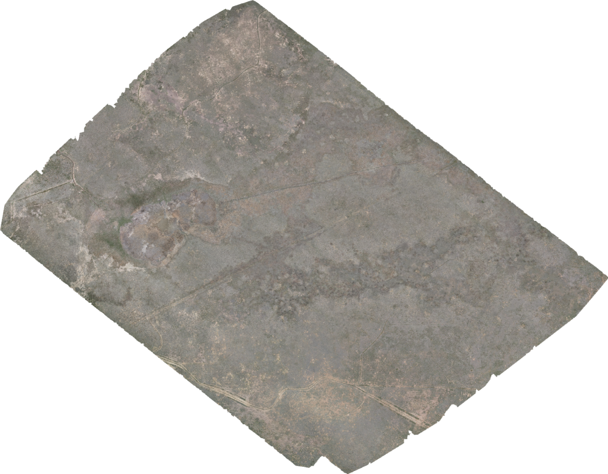
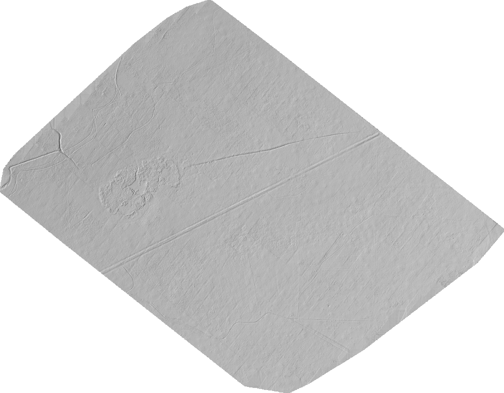
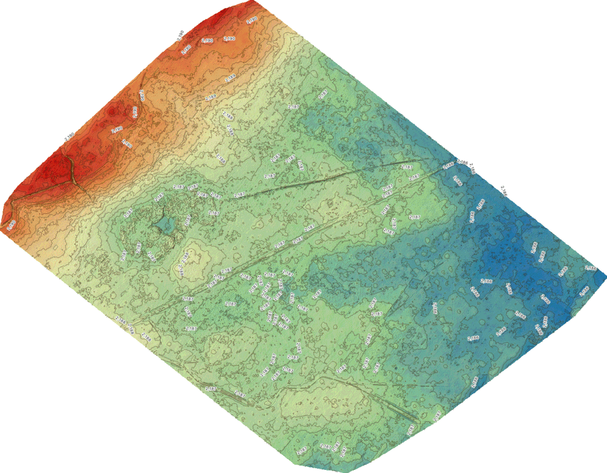
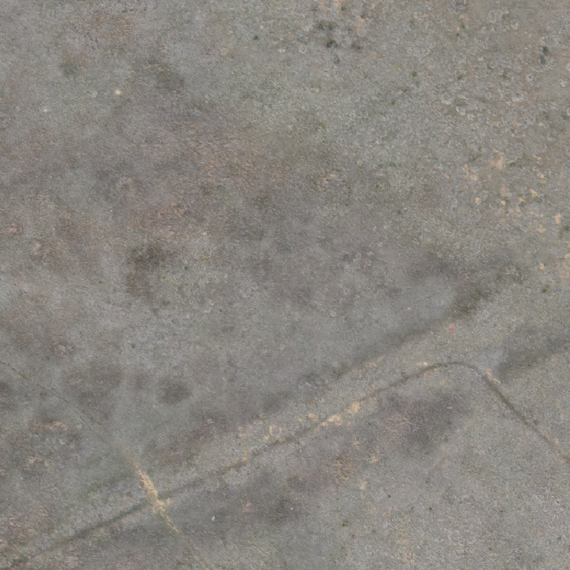
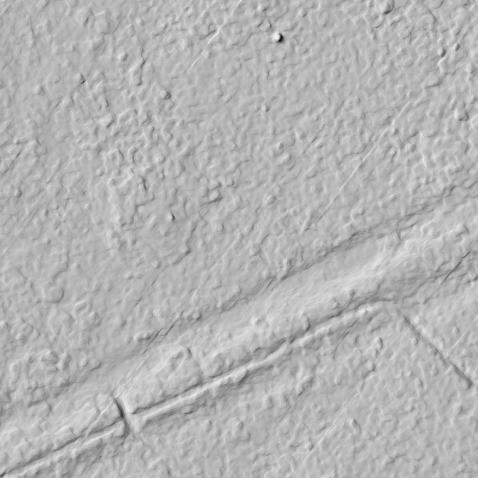
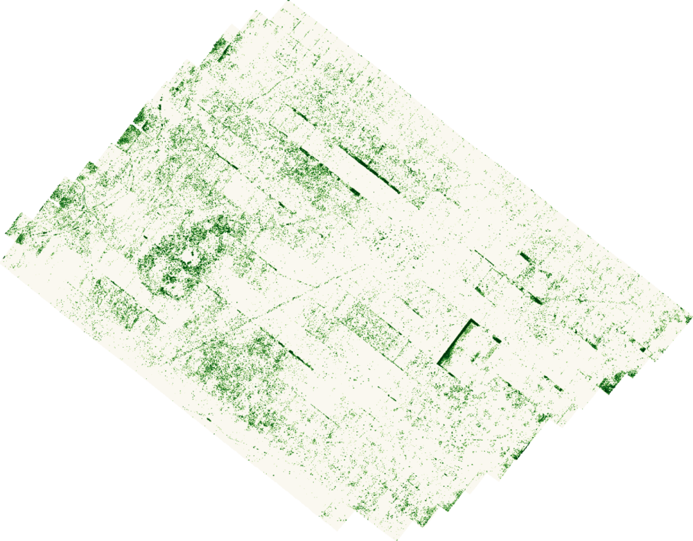

# RangeLand DroneMaps

Reproducible, open-source photogrammetry workflow that turns drone survey photos of rangeland into
**orthomosaic GeoTIFFs, digital surface and terrain models (DSM/DTM), vegetation height models,
contours, classified point clouds and textured 3D models**.

Engine: [OpenDroneMap](https://github.com/OpenDroneMap/ODM) (Docker), post-processing with [GDAL](https://gdal.org),
viewing in [QGIS](https://qgis.org). Tested on macOS / Apple Silicon (M1 Max, 64 GB).

> 📄 **Results report with viewing/interpretation guide: [docs/REPORT.md](docs/REPORT.md)**.
> 📦 **Final mapping products:** `deliverables/2026-05-21_Map/` (kept locally, not in git; see [Products](#products-2026-05-21_map)).
> 🗺️ **Pre-styled QGIS project:** `qgis/2026-05-21_Map.qgz`.

## Quick start

```bash
# one-time setup
brew install colima docker gdal
colima start --cpu 8 --memory 48 --disk 300 --arch aarch64 --vm-type vz --mount-type virtiofs
docker pull opendronemap/odm:3.6.2

# 1. inventory / QA of the images
python3 scripts/inventory_images.py 2026-05-21_Map/Images_Mapping

# 2. photogrammetry (orthophoto, DSM, DTM, point cloud, 3D model, report)
scripts/run_odm.sh 2026-05-21_Map/Images_Mapping 2026-05-21_Map full

# 3. derived products (hillshade, slope, contours, canopy height model)
scripts/postprocess.sh processing/2026-05-21_Map 0.5

# 4. fine-scale vegetation height / cover for short vegetation
scripts/vegetation_chm.sh processing/2026-05-21_Map 0.10

# 5. vertical correction against USGS 3DEP lidar (+ terrain products from corrected DEMs)
QPY=/Applications/QGIS-final-4_2_3.app/Contents/MacOS/python   # any Python with GDAL+numpy
$QPY scripts/correct_dem_3dep.py processing/2026-05-21_Map
DSM=processing/2026-05-21_Map/corrected/dsm_navd88.tif DTM=processing/2026-05-21_Map/corrected/dtm_navd88.tif \
  OUT=processing/2026-05-21_Map/derived_navd88 scripts/postprocess.sh processing/2026-05-21_Map 0.25

# 6. report figures + QGIS project
$QPY scripts/make_report_figures.py processing/2026-05-21_Map 2026-05-21_Map/metadata/Images_Mapping_inventory.csv docs/report/fig
QT_QPA_PLATFORM=offscreen $QPY scripts/make_qgis_project.py processing/2026-05-21_Map \
  2026-05-21_Map/metadata/Images_Mapping_cameras.geojson qgis/2026-05-21_Map.qgz docs/report/fig
```

## Repository layout

```
.
├── README.md
├── docs/
│   ├── REPORT.md            # results report: products, viewing, interpretation, accuracy
│   ├── report/fig/          # report figures
│   ├── WORKFLOW.md          # step-by-step processing guide
│   ├── DATA.md              # dataset description, flight parameters, accuracy notes
│   ├── SOFTWARE.md          # tool choices, licenses, alternatives
│   ├── VEGETATION.md        # fine-scale vegetation height: method, parameter test, artifacts
│   └── PROCESSING_LOG.md    # record of every processing run and its results
├── config/
│   ├── odm_full.args        # full-quality ODM profile (commented)
│   ├── odm_test.args        # reduced-quality end-to-end test profile
│   └── odm_preview.args     # fast-orthophoto preview profile
├── scripts/
│   ├── inventory_images.py  # EXIF/XMP inventory, flight summary, camera GeoJSON (stdlib only)
│   ├── run_odm.sh           # runs ODM in Docker with a profile; logs everything
│   ├── postprocess.sh       # GDAL: hillshade, slope, color relief, CHM, contours, summary
│   ├── vegetation_chm.sh    # PDAL fine ground filter → height above ground, vegetation cover
│   ├── correct_dem_3dep.py  # vertical check + bowl/offset correction against USGS 3DEP lidar
│   ├── export_section.sh    # point-cloud slice → CSV (cross-sections)
│   ├── make_glb.sh          # textured mesh → .glb 3D model (ODM's converter)
│   ├── make_deliverables.sh # copy final products to deliverables/<survey>/ with final names
│   ├── cleanup_intermediate.sh  # delete ODM intermediate data (dry run by default)
│   ├── make_report_figures.py  # figures for docs/REPORT.md (matplotlib + GDAL)
│   └── make_qgis_project.py # pre-styled QGIS project + example map renders (PyQGIS)
├── qgis/
│   └── 2026-05-21_Map.qgz   # pre-styled QGIS project (opens the local working outputs)
├── 2026-05-21_Map/          # one folder per survey
│   ├── Images_Mapping/      # raw nadir images (NOT in git)
│   ├── Images_Nav/          # ground-level takeoff photos (NOT in git, not processed)
│   └── metadata/            # inventory CSV, camera GeoJSON, SHA-256 checksums (in git)
├── deliverables/            # final products per survey + README.txt (NOT in git)
└── processing/              # local working folder for scripts (NOT in git; regenerable)
```

## Surveys

| Survey | Drone / camera | Images | Altitude | GSD | Area | Status |
|---|---|---|---|---|---|---|
| [2026-05-21_Map](docs/DATA.md) | DJI Air 2S (FC3411) | 494 nadir | 61 m AGL | 1.82 cm | 97.6 ha | ✅ processed, see [REPORT](docs/REPORT.md) · [log](docs/PROCESSING_LOG.md) |

### Products (2026-05-21_Map)

In `deliverables/2026-05-21_Map/` (4.2 GB). UTM 13N (EPSG:32613), heights in metres NAVD88.

| Product | File | Size |
|---|---|---|
| Orthophoto, 2 cm | `2026-05-21_orthophoto_2cm.tif` | 2.9 GB |
| DTM (bare ground), 5 cm, corrected to USGS 3DEP | `2026-05-21_DTM_5cm_NAVD88.tif` | 306 MB |
| DSM (surface), 5 cm, corrected to USGS 3DEP | `2026-05-21_DSM_5cm_NAVD88.tif` | 306 MB |
| Contours, 0.25 m | `2026-05-21_contours_0.25m_NAVD88.gpkg` | 3 MB |
| Terrain slope, 1 m | `2026-05-21_slope_1m_degrees.tif` | 3 MB |
| Vegetation cover ≥ 10 cm, 1 m (approximate) | `2026-05-21_vegetation_cover_1m.tif` | 1 MB |
| Point cloud, classified + height above ground | `2026-05-21_point_cloud_classified_HAG.laz` | 596 MB |
| Textured 3D model (glTF) | `2026-05-21_3D_model_textured.glb` | 257 MB |
| ODM quality report | `2026-05-21_ODM_quality_report.pdf` | 9 MB |

The point cloud Z values and the 3D model use ODM's raw (uncorrected) heights. See the folder's `README.txt` and [REPORT §2](docs/REPORT.md#2-what-was-produced).

### 2026-05-21_Map results

| Orthophoto (2 cm) | DTM hillshade (5 cm) | Corrected DTM (NAVD88) + 0.25 m contours |
|---|---|---|
|  |  |  |

Raw ODM heights were bowl-shaped (13.6 m) and 40.8 m low. Corrected against USGS 3DEP lidar to 0.12 m RMSE ([REPORT §5.2](docs/REPORT.md#52-elevation-why-the-corrected-layers-matter)).

Detail (60 × 60 m): orthophoto vs DSM hillshade. Two-tracks, an incised drainage and individual plant clumps are visible.

| Orthophoto detail | DSM hillshade detail |
|---|---|
|  |  |

Fine-scale vegetation (see [docs/VEGETATION.md](docs/VEGETATION.md)): vegetation cover ≥ 10 cm on 1 m cells
(left) and max height above ground (right). Straight bands are known photogrammetry artifacts (ghost layers from the
low 50 % side overlap), not vegetation.

| Vegetation cover ≥ 0.10 m | Max height above ground |
|---|---|
|  |  |

## Adding a new survey

1. Create `YYYY-MM-DD_<Name>/Images_Mapping/` and copy in **only nadir mapping images**.
2. `python3 scripts/inventory_images.py YYYY-MM-DD_<Name>/Images_Mapping -o .../metadata/inventory.csv --geojson .../metadata/cameras.geojson`
3. `scripts/run_odm.sh YYYY-MM-DD_<Name>/Images_Mapping YYYY-MM-DD_<Name> full`
4. `scripts/postprocess.sh processing/YYYY-MM-DD_<Name>`
   (+ `scripts/vegetation_chm.sh processing/YYYY-MM-DD_<Name>` for short vegetation)
5. Vertical check/correction against USGS 3DEP (`correct_dem_3dep.py`), then `postprocess.sh` on the corrected DEMs
   (see Quick start step 5).
6. `scripts/make_deliverables.sh YYYY-MM-DD_<Name>` copies the final products to `deliverables/`. Add a `README.txt`.
   Then run `scripts/cleanup_intermediate.sh YYYY-MM-DD_<Name> --yes` (see [WORKFLOW §6](docs/WORKFLOW.md#6-deliverables-and-cleanup)).
7. Add a section to `docs/DATA.md` and an entry to `docs/PROCESSING_LOG.md`.

## Data and outputs

**Deliverables:** the essential mapping products (orthophoto, corrected DTM/DSM, contours, slope, vegetation cover,
point cloud, textured 3D model (.glb), QA report; ~4.2 GB) are copied with descriptive names into `deliverables/<survey>/` with a `README.txt`
(CRS, units, accuracy, caveats). Use that folder for archiving or sharing. It is excluded from git.

Raw imagery (3.6 GB for this survey) and the local working folder (~13 GB after cleanup) are excluded from git
(see `.gitignore`). Archive them separately, e.g. on institutional storage, Zenodo or an S3 bucket. Checksums
are tracked in `*/metadata/sha256sums.txt`. Use [Git LFS](https://git-lfs.com) or a GitHub Release if you
want to publish small final products such as a downsampled orthophoto.

## License

Code and documentation in this repository: MIT (see `LICENSE`). OpenDroneMap is AGPL-3.0 and is
used unmodified as a Docker container.
