# Results report: 2026-05-21 rangeland drone survey

**Site:** short-grass rangeland near Laramie, Wyoming (≈ 41.275° N, 105.669° W)
**Survey:** 2026-05-21, DJI Air 2S, 494 nadir photos, 61 m above ground, 3 flights
**Processing:** 2026-11-05, OpenDroneMap 3.6.2 + PDAL + GDAL, checked against USGS 3DEP lidar

This report explains what was produced, how to open each product, and how to read it, with worked examples.
Methods are in [WORKFLOW.md](WORKFLOW.md), the dataset in [DATA.md](DATA.md), the vegetation analysis in
[VEGETATION.md](VEGETATION.md), and the run history in [PROCESSING_LOG.md](PROCESSING_LOG.md).

---

## 1. Summary

| | Result |
|---|---|
| Area mapped | **97.6 ha** (≈ 1.2 × 0.94 km) |
| Images used | **494 / 494** aligned into one model (0.90 px mean reprojection error) |
| Orthophoto | **2 cm** pixels (native ground resolution 1.8 cm), seamless |
| Elevation models | DSM and DTM at **5 cm**. Fine DTM and vegetation height at **10 cm** |
| Point cloud | **126.8 million** points, classified, with height above ground |
| Vertical accuracy | Raw ODM heights: **−40.8 m offset plus a 13.6 m bowl distortion**. After correcting to USGS 3DEP: **12 cm RMSE**, 90 % of the area within ±0.2 m |
| Relative accuracy (internal) | ≈ 4 cm horizontal, 5 cm vertical (ODM report) |
| Terrain | Gentle: 2185.3 – 2191.4 m (NAVD88), median slope 1.5°, falling from NW to SE |
| Vegetation ≥ 10 cm tall | **3.9 %** of the area (includes known artifacts, see §5.5) |

**Key messages**

1. **The orthophoto and the local relief are high quality.** Trails, two-tracks, drainages, a circular
   disturbance feature and individual plant clumps are all clearly resolved.
2. **Use the delivered DTM/DSM (`*_NAVD88.tif`) for any heights, slopes or contours.** They are corrected to
   USGS lidar. ODM's raw heights were bowl-shaped because no ground control was used (§5.2).
3. **Vegetation height is at the limit of what this data can resolve.** Plants here are 5–20 cm tall,
   about the same size as photogrammetric errors where photos overlap. Patterns are real; absolute cover values are approximate.

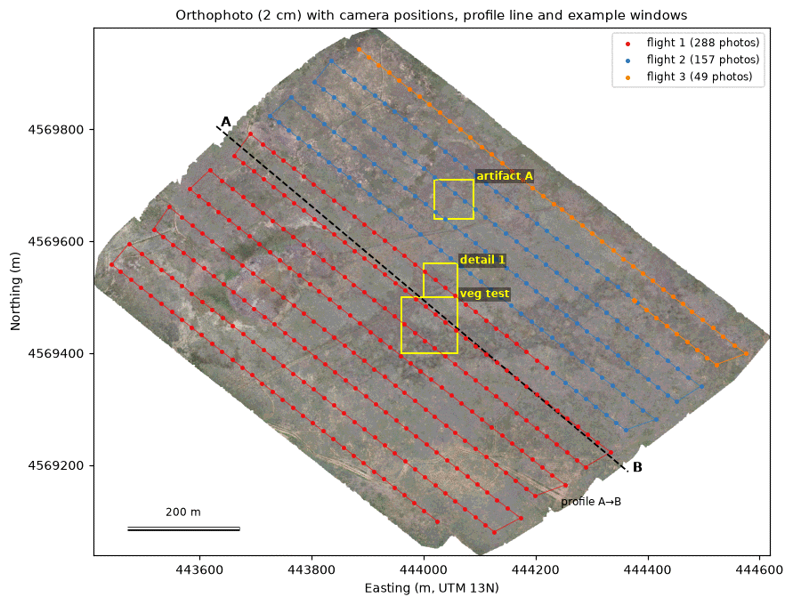
*Figure 1. Orthophoto with the 494 camera positions (three flights), the profile line A→B used in §5.2, and
the example windows used below. Grid in metres, UTM zone 13N (EPSG:32613).*

---

## 2. What was produced

The final products are in **`deliverables/2026-05-21_Map/`** (4.2 GB, kept locally, not in git), together with a
`README.txt` describing each file. Every file uses **WGS 84 / UTM 13N (EPSG:32613)**. Heights are metres above **NAVD88**.

| Product | File | Size | Units / resolution | Use it for |
|---|---|---|---|---|
| Orthophoto | `2026-05-21_orthophoto_2cm.tif` | 2.9 GB | RGB, 2 cm | Mapping features, digitizing, visual assessment, area measurement |
| **DTM** (bare ground) | `2026-05-21_DTM_5cm_NAVD88.tif` | 306 MB | m NAVD88, 5 cm | Elevation, profiles, drainage, volume |
| **DSM** (surface) | `2026-05-21_DSM_5cm_NAVD88.tif` | 306 MB | m NAVD88, 5 cm | Top-of-surface elevation including plants |
| Contours | `2026-05-21_contours_0.25m_NAVD88.gpkg` | 3 MB | 0.25 m interval, attribute `elev_m` | Maps, drainage patterns |
| Terrain slope | `2026-05-21_slope_1m_degrees.tif` | 3 MB | degrees, 1 m | Slope classes, erosion risk |
| Vegetation cover | `2026-05-21_vegetation_cover_1m.tif` | 1 MB | fraction 0–1, 1 m | Cover patterns (approximate, §5.5) |
| Point cloud | `2026-05-21_point_cloud_classified_HAG.laz` | 596 MB | 126.8 M points, ground/other + `HeightAboveGround` | 3D viewing, cross-sections, custom analysis |
| 3D model | `2026-05-21_3D_model_textured.glb` | 257 MB | glTF 2.0, textured | Presentations, 3D viewing (§3.2) |
| QA report | `2026-05-21_ODM_quality_report.pdf` | 9 MB | | Processing quality (§5.7) |

**Heights:** the DTM, DSM and contours are **corrected to USGS 3DEP lidar** (§5.2). The point cloud's Z values and
the 3D model still carry ODM's raw heights (about 41 m low and bowl-shaped). The point cloud's `HeightAboveGround`
is relative and unaffected. The elevation previews inside the QA report PDF also show raw heights.

**Further layers** used in this report are kept in the local working folder and can be regenerated with the
scripts. They are available on request: vegetation height (10 cm), vegetation mask, fine DTM (10 cm), hillshades,
the USGS 3DEP reference DEM and the vertical-check rasters.

---

## 3. How to view the results

### 3.1 QGIS (recommended): open the ready-made project

**Quickest:** drag the files from `deliverables/2026-05-21_Map/` into a new QGIS project.

**Full styled project:** `qgis/2026-05-21_Map.qgz` in the repository has every layer pre-styled, including the
further layers listed in §2. It reads the local working outputs, so it opens fully on the processing computer,
or after rerunning the workflow.

1. Install [QGIS](https://qgis.org) (3.34 or newer; tested with 4.2).
2. *Project → Open…* → `qgis/2026-05-21_Map.qgz`.
3. The *Layers* panel shows five groups. Tick layers on and off to compare:

| Group | Layers | Shown at start |
|---|---|---|
| Vegetation (fine ground filter) | cover 1 m, vegetation height, mask, point cloud | off |
| Terrain, corrected to USGS 3DEP | contours, DTM hillshade (multiply blend), DTM colour, slope, DSM, DSM hillshade | contours + hillshade + DTM |
| QA / accuracy | raw-minus-3DEP difference, residual after correction, USGS 3DEP | off |
| ODM raw outputs | raw DTM/DSM/hillshade | off |
| Imagery | orthophoto, camera positions | orthophoto |

The first time the point cloud is switched on, QGIS builds an index (a `.copc.laz` file next to it), which takes about a minute.

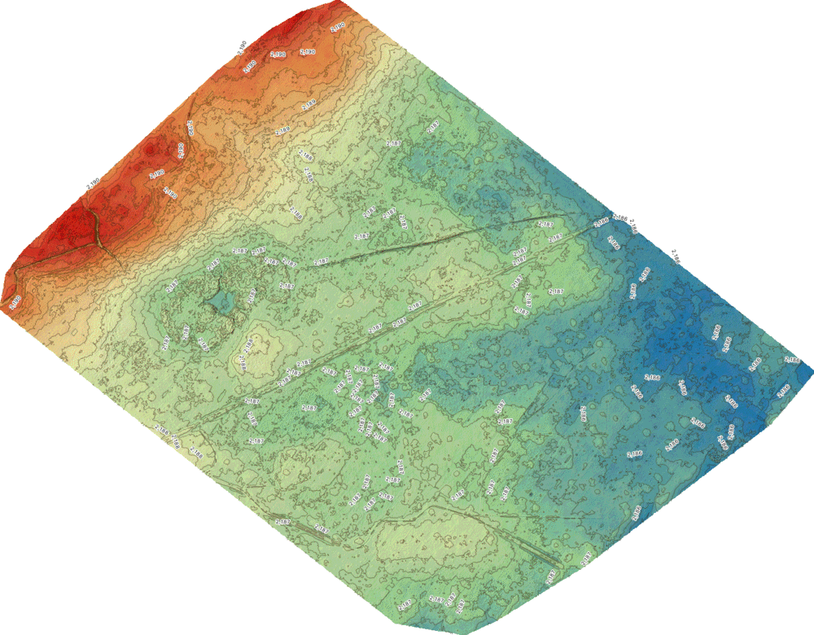
*Figure 2. The project's starting view: corrected DTM in colour, with hillshade and 0.25 m contours
(labelled every metre). Red = high (NW), blue = low (SE).*

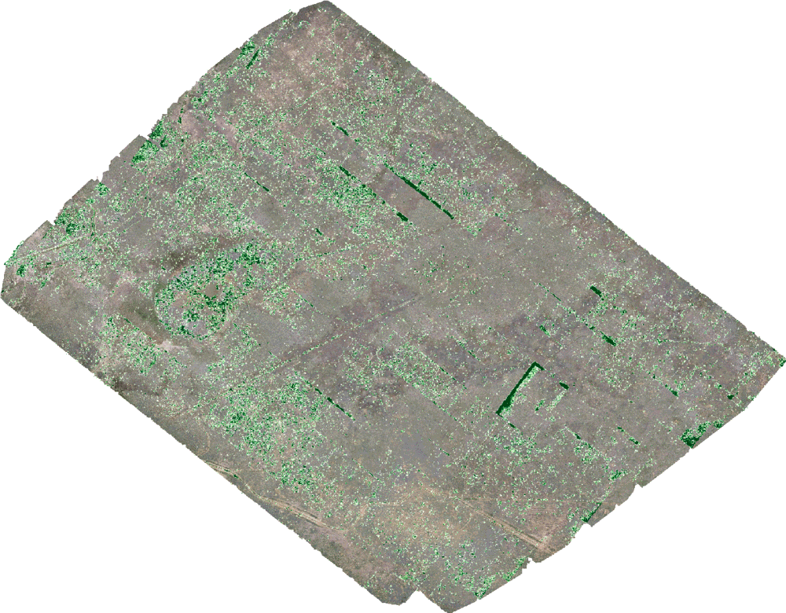
*Figure 2b. Same project with the vegetation-cover layer switched on over the orthophoto (green = more vegetation
≥ 10 cm per square metre). The straight dark-green bands are artifacts (§5.5).*

**Useful QGIS tools for this data**

| Task | How |
|---|---|
| Read the value under the cursor (elevation, vegetation height) | *Identify Features* (`Ctrl/Cmd+Shift+I`), click on the map |
| Elevation profile along a line (like Figure 4) | *View → Elevation Profile*. Draw a line. Add the DTM, DSM and point cloud layers |
| Measure distance / area | *Measure Line* / *Measure Area* (toolbar ruler) |
| Compare two layers | Select the top layer → *Layer Properties → Transparency*, or toggle it on and off |
| 3D view | *View → 3D Map Views → New 3D Map View*. Set the terrain to `DTM corrected (NAVD88)` and drape the orthophoto |
| Zonal statistics (e.g., cover per pasture) | Draw or load polygons → *Processing Toolbox → Zonal statistics* on the vegetation cover layer |
| Cross-section of the point cloud | Point cloud layer → *Elevation Profile* tool with a narrow tolerance (0.2–0.5 m) |
| Change the colour stretch | *Layer Properties → Symbology*: set min/max, colour ramp |

To rebuild the project after reprocessing, see §9.

### 3.2 Other viewers

| Product | Viewer | Notes |
|---|---|---|
| Point clouds (`.laz`) | [CloudCompare](https://www.cloudcompare.org) (free) | Colour by *Classification* or the scalar field *HeightAboveGround*. *Edit → Cross Section* for slices |
| Point clouds (web) | [plas.io](https://plas.io), [potree](https://potree.github.io) | Drag in a `.laz` (best with smaller subsets) |
| **3D model (`.glb`)** | Drag onto [gltf-viewer.donmccurdy.com](https://gltf-viewer.donmccurdy.com) or [3dviewer.net](https://3dviewer.net) (both run locally in the browser), Blender (*File → Import → glTF*), macOS Preview/Reality Composer, Windows 3D Viewer | 257 MB: Draco-compressed mesh (197k vertices) + 64 JPEG textures. Positioned in UTM 13N via `CESIUM_RTC` (centre 443997 E, 4569496 N), so it also loads into Cesium. Heights are ODM's raw (bowl-shaped) values |
| Any GeoTIFF, quickly | `gdalinfo -stats file.tif` prints the CRS, size and value range | |
| Everything in a browser | [WebODM](https://github.com/OpenDroneMap/WebODM) | Optional GUI. Import the images or the finished assets |

---

## 4. Processing chain (what was done)

```
494 JPGs ─► ODM 3.6.2 (Docker/Colima) ─────────────► orthophoto 2 cm, DSM/DTM 5 cm, point cloud, mesh, QA report
  │          SfM + rolling-shutter correction, dense MVS (high), SMRF ground filter
  │
  ├─► postprocess.sh (GDAL) ───────────────────────► hillshade, slope, colour relief, contours
  ├─► vegetation_chm.sh (PDAL, fine SMRF) ─────────► height above ground, vegetation height/mask/cover, fine DTM
  ├─► correct_dem_3dep.py (USGS 3DEP lidar) ───────► offset + bowl removed → DTM/DSM in NAVD88
  │       └─► postprocess.sh on corrected DEMs ─────► hillshade, 1 m slope, 0.25 m contours (NAVD88)
  ├─► make_glb.sh ─────────────────────────────────► textured 3D model (.glb)
  └─► make_report_figures.py, make_qgis_project.py ► this report, QGIS project
                                                      → final products copied to deliverables/
```

Total compute time on an M1 Max (64 GB): ODM 3 h 07 m. Everything else ≈ 25 min.
The `.glb` model was created afterwards from the existing textured mesh with `scripts/make_glb.sh` (1.5 min).

---

## 5. Interpreting the results

### 5.1 Orthophoto

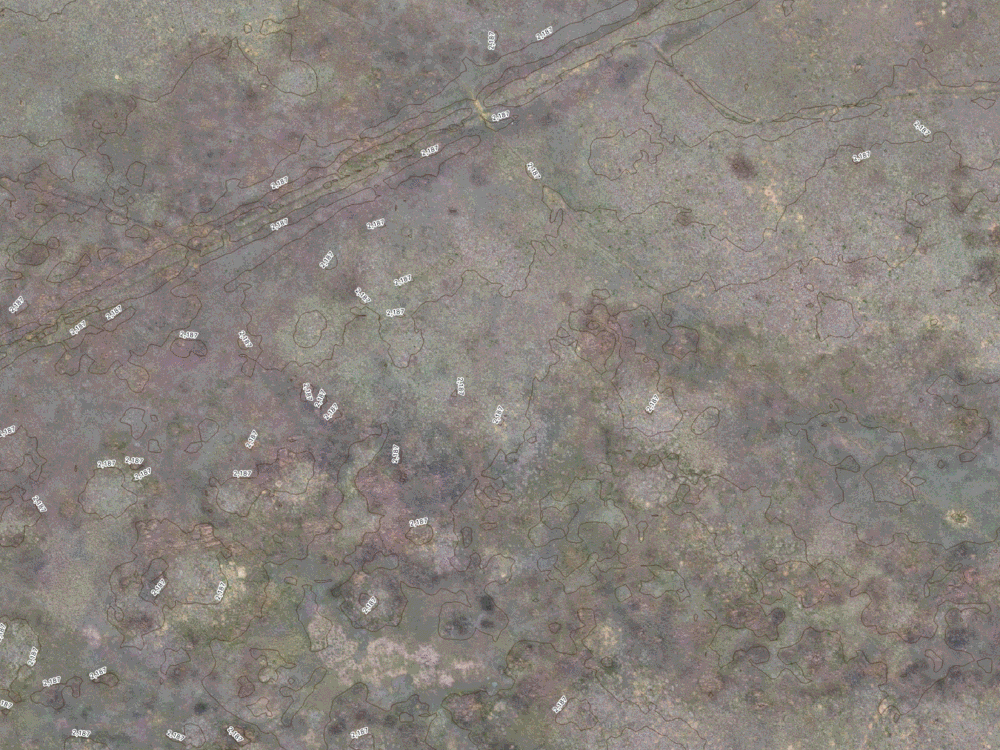
*Figure 3. Orthophoto at full detail (200 × 150 m) with 0.25 m contours. Two-track roads (upper left), bare-soil
patches (light), denser bunchgrass (darker mottling) and individual plant clumps are visible.*

**How to read it**
- Each pixel is 2 × 2 cm, so features larger than about 5–10 cm can be identified, and the map is geometrically true (no tilt or perspective).
  Distances and areas can be measured directly.
- Colour reflects the sun at 12:51–13:38 local time on 21 May: short shadows, slight colour differences between
  flights. Don't use raw RGB values as a vegetation index without calibration.
- Absolute position comes from the drone's GPS only (typically 1–3 m). Overlays with other data (fences, plot
  corners, satellite images) can be off by that much. Relative positions within the map are accurate to a few cm.

### 5.2 Elevation: why the corrected layers matter

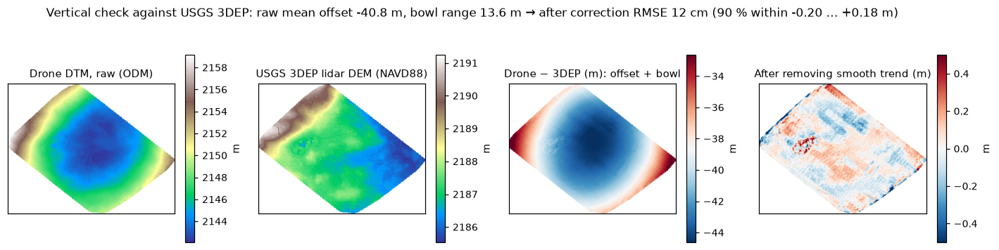
*Figure 4. Left to right: ODM's raw DTM; the USGS 3DEP lidar DEM; their difference; the difference after
removing a smooth 2nd-order trend.*

ODM had only the drone's GPS to place the model in space. That causes two systematic errors:

1. **A constant offset (−40.8 m).** The drone records heights in a different reference than survey
   data (NAVD88). This is expected and easy to remove.
2. **A bowl ("doming") distortion of 13.6 m across the site.** The middle is too low and the edges too high.
   This is a known weakness of structure-from-motion with nadir-only photos and no ground control. The camera
   lens parameters and the surface curvature trade off against each other.

The fix: compare against the USGS 3DEP lidar DEM, fit a smooth surface to the difference, and subtract it
(`scripts/correct_dem_3dep.py`). Afterwards the drone DTM matches the lidar to **12 cm RMSE**, and 90 % of cells
fall within −0.20…+0.18 m. The remaining differences (right panel) are mostly real. The circular feature differs by
up to ±0.8 m, possibly a pond, excavation or other change since the lidar was flown. There is also faint striping from
image overlap (§5.5).

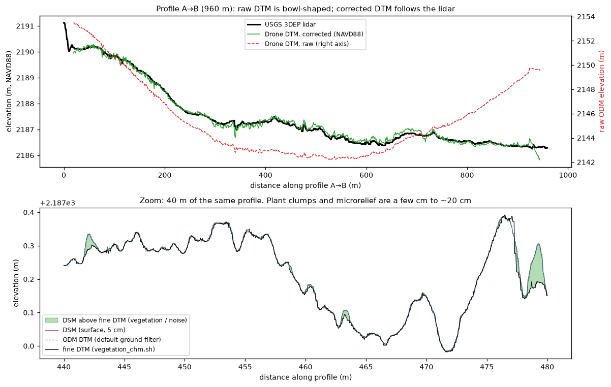
*Figure 5. Top: profile A→B across the whole site. The raw DTM (red dashed, right axis) curves upward at both
ends. The corrected DTM (green) follows the lidar (black). Bottom: 40 m of the same profile at 5 cm sampling.
Micro-relief of 10–40 cm (hummocks, ruts) and small plant clumps (green fill) show up. Neither is visible in the lidar.*

**How to read elevations**
- Use the delivered `*_DTM_5cm_NAVD88.tif` / `*_DSM_5cm_NAVD88.tif`. Values are metres above the NAVD88 datum, comparable with USGS maps and survey data.
- Local height differences (within tens of metres) were accurate even in the raw data. Only the large-scale shape was wrong.
- The correction assumes the terrain hasn't changed much since the lidar survey. Where it has (ponds,
  earthworks), the drone data show the present state, as intended.

### 5.3 Terrain products: relief, contours, slope

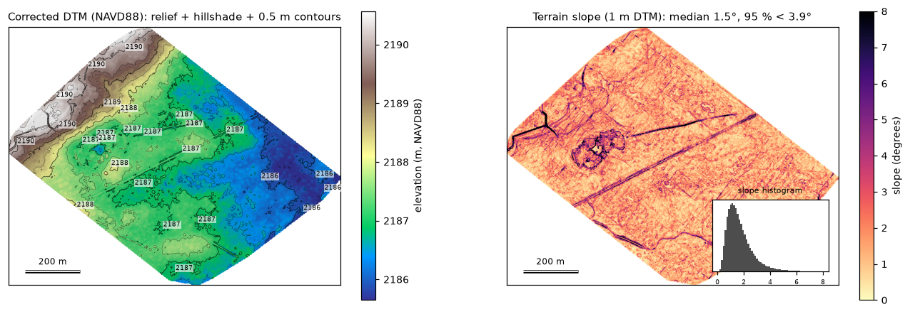
*Figure 6. Left: corrected DTM (colour + hillshade + 0.5 m contours). Right: terrain slope from the DTM averaged
to 1 m, with a histogram.*

**Reading the terrain**
- The site falls about **5 m from the NW corner (≈ 2190.5 m) to the SE (≈ 2185.5 m)**. A steeper NW edge
  holds a small branching drainage (upper left).
- **Contours** run NE–SW, perpendicular to the main slope. Closely spaced contours = steeper ground. Small closed
  loops = hummocks or depressions. The 0.25 m interval suits this low-relief site. Contours are generated from the 1 m DTM,
  so they follow terrain rather than individual grass clumps.
- **Slope** is gentle almost everywhere: median 1.5°, 95 % below 3.9°. The highest slopes are linear features:
  road ruts and berms, drainage banks, and the rim of the circular feature. These are where runoff
  concentrates and erosion is most likely.
- `dtm_slope_deg.tif` (5 cm) is also available, but at that scale slope mostly measures the roughness of
  grass hummocks (median ≈ 5°). Use the **1 m** version for terrain slope.

### 5.4 Surface (DSM) vs terrain (DTM) vs vegetation height

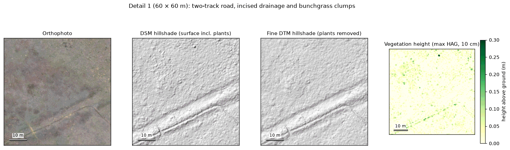
*Figure 7. A 60 × 60 m window. Orthophoto; DSM hillshade (surface including plants); fine DTM hillshade (low
plants removed); vegetation height. The two-track road and the incised drainage are terrain. The small bumps that
disappear between DSM and fine DTM are plant clumps.*

- **DSM** = top of whatever the camera saw (ground, grass, shrubs, livestock, vehicles).
- **DTM** = estimated bare ground. ODM's default DTM treats anything under ~0.5 m as ground, so on this
  short-grass site **ODM's DTM ≈ DSM**. The **fine DTM** from `vegetation_chm.sh` removes clumps down to about 5 cm.
- **Vegetation height** = height of each point above the fine DTM, as the maximum per 10 cm cell. On this site
  most values are 0–20 cm. Isolated values of 0.3–0.7 m are taller shrubs, rocks or objects. Check them in the orthophoto.

### 5.5 Vegetation cover and height (read with care)

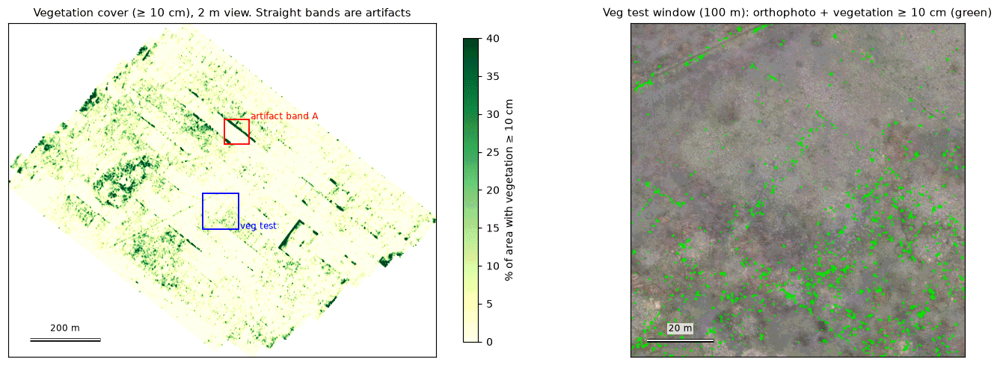
*Figure 8. Left: percentage of each area covered by vegetation ≥ 10 cm tall. Right: a 100 m window with the
10 cm vegetation mask (green) on the orthophoto.*

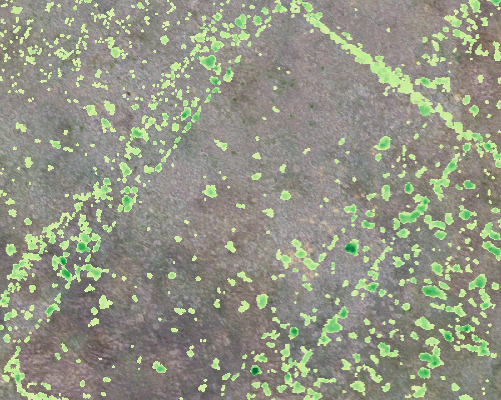
*Figure 9. 50 × 40 m in QGIS: vegetation height (light → dark green = 5 → 30 cm) on the orthophoto. Blobs
match bunchgrass clumps. The straight diagonal stripe (upper right) is an artifact.*

**What is real:** clump-scale vegetation (0.3–1 m across, 10–30 cm tall) concentrated in the darker, more vegetated
patches of the orthophoto. There is a ring of denser/taller vegetation around the circular feature, and sparse cover on bare-soil areas.

**What is not real: straight bands and an L-shape.** They run parallel or perpendicular to the flight lines and
have no counterpart in the orthophoto. The point-cloud cross-sections explain them:

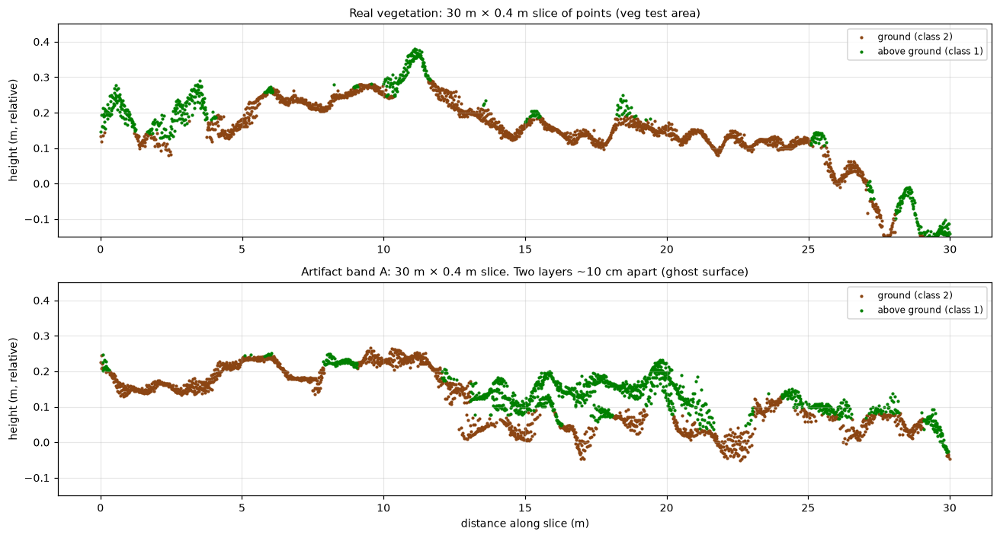
*Figure 10. 30 m slices through the point cloud. Top: real vegetation. Above-ground points (green) form
discrete bumps on a single ground surface. Bottom: an artifact band. Two parallel surfaces ~10 cm apart
(a "ghost layer" where overlapping photos disagree slightly). The upper one is wrongly counted as vegetation.*

**How to use the vegetation layers**
- Use them for **patterns and relative comparisons** (where vegetation is denser or taller), not as absolute
  cover or height values.
- **Ignore straight bands** aligned with the flight lines (NW–SE) or perpendicular to them. If summarizing cover
  by area, digitize the bands as an exclusion mask or check results against the orthophoto.
- Photogrammetry sees the top of the canopy from above and smooths thin leaves. Measured heights are lower
  than plant heights measured in the field. Calibrate against field measurements if you need real heights.
- Site-wide cover of vegetation ≥ 10 cm is **3.9 %**. This includes artifact bands, so the true figure is somewhat lower.

Details, the parameter test and everything tried to remove the artifacts: [VEGETATION.md](VEGETATION.md).

### 5.6 3D view

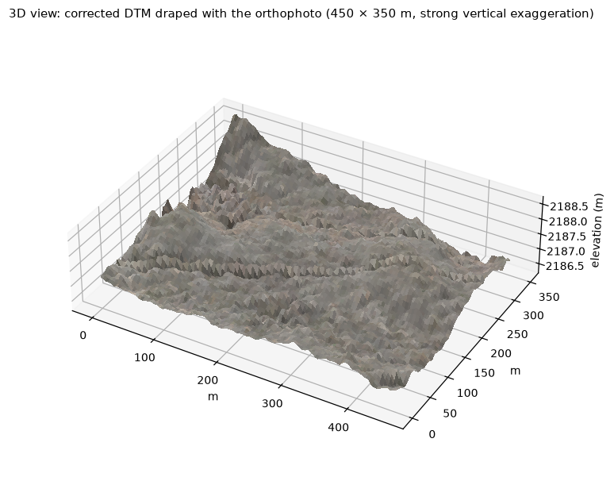
*Figure 11. Corrected DTM draped with the orthophoto (450 × 350 m, heavy vertical exaggeration: the real
relief here is only ~3 m). For interactive 3D, open the textured model `2026-05-21_3D_model_textured.glb` in a glTF
viewer (§3.2), use a QGIS 3D map view, or load the point cloud in CloudCompare.*

When viewing the `.glb`, remember the relief is real but subtle (about 5 m over 1 km). Most viewers show it
without vertical exaggeration, so the site looks flat. The textured surface is most useful zoomed in
(ruts, the circular feature, drainage banks).

### 5.7 Processing quality (ODM report)

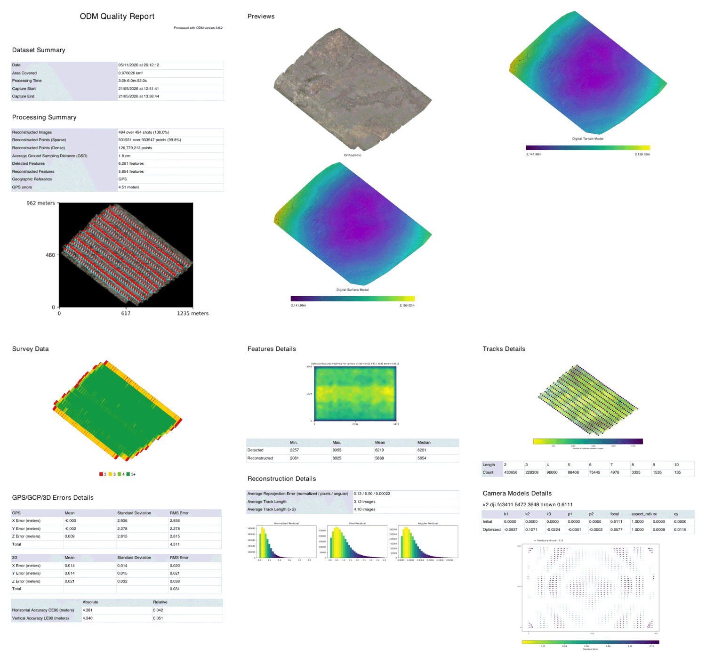
*Figure 12. The six pages of the ODM quality report (`2026-05-21_ODM_quality_report.pdf`). Its elevation previews show raw heights.*

| Panel | What to look for | This survey |
|---|---|---|
| Dataset / processing summary | Reconstructed images ≈ 100 %, GSD as planned | 494/494 (100 %), GSD 1.8 cm ✅ |
| Camera positions (page 1, bottom) | Regular lines, no gaps | 13 parallel lines ✅ |
| Survey data: overlap map (page 4) | Green (5+ images) over the area of interest | Green inside, yellow/red only at the fringe ✅ |
| GPS errors | A few m without RTK/GCPs is normal | 4.5 m average (2.9 / 2.3 / 2.8 m in x/y/z) ✅ |
| Absolute vs relative accuracy | Relative = internal consistency | CE90 4.4 m / LE90 4.3 m absolute. **4 cm / 5 cm relative** ✅ |
| Reprojection error | < 1–1.5 px is good | 0.90 px ✅ |
| Track length | Longer = each point seen in more images | 3.1 images average. Short because of the low overlap ⚠️ |
| Camera model residuals (page 6) | Small, random arrows | Radial pattern at the edges. Lens calibration is coupled with the bowl effect ⚠️ |

---

## 6. Accuracy at a glance

| Aspect | Value | Basis |
|---|---|---|
| Pixel size | 2 cm ortho, 5 cm DEM | processing settings |
| Relative horizontal | ≈ 4 cm | ODM relative CE90 |
| Relative vertical | ≈ 5 cm | ODM relative LE90 |
| Absolute horizontal | ≈ 1–4 m (not independently checked) | drone GPS, ODM absolute CE90 4.4 m |
| Absolute vertical, raw ODM | −40.8 m offset, 13.6 m bowl | vs USGS 3DEP |
| **Absolute vertical, corrected** | **0.12 m RMSE** (90 % within ±0.2 m) | vs USGS 3DEP lidar, 156,000 comparison cells |
| Vegetation height | ±5–10 cm noise. Artifacts up to ~20 cm in bands | point-cloud analysis (§5.5) |

## 7. Which layer for which question?

| Question | Layer(s) | Caveat |
|---|---|---|
| Where are roads, trails, bare patches, water points? | Orthophoto, DTM hillshade | |
| How big is feature X? | Orthophoto (measure tool) | |
| Which way does water flow; where does it collect? | Corrected DTM, contours, slope 1 m | |
| Elevation of a point / a profile | Corrected DTM (NAVD88) | ±0.12 m |
| How deep is this rut / drainage? | Corrected DTM or DSM, profile tool | Relative heights ±5 cm |
| Where is vegetation denser or taller? | Vegetation cover 1 m, vegetation height | Ignore straight bands |
| How much vegetation cover in this pasture? | `2026-05-21_vegetation_cover_1m.tif` + zonal statistics | Approximate. Report the 10 cm threshold |
| Did the terrain change since an earlier survey? | Corrected DTM vs earlier corrected DTM | Both need the same correction or GCPs |

## 8. Limitations and recommendations

**Limitations of this survey**
- No ground control points or RTK: absolute positions are approximate. Heights rely on the 3DEP correction.
- Side overlap of only 50 % causes the ghost-layer artifacts in vegetation height and faint striping in hillshades.
- Short vegetation (5–20 cm) is close to the vertical noise level.

**For the next survey**
1. Raise overlap to **≥ 75 % front / 70 % side** (80/75 % for vegetation work).
2. Place **5–10 ground control points** (or fly with RTK/PPK) for absolute accuracy without a lidar reference.
3. Add **oblique photos** (gimbal −60° to −70°, crosshatch) to remove the bowl effect and see plant sides.
4. For vegetation structure, fly sample plots at **30–40 m** in calm wind. Collect field heights for calibration.
5. Re-use this workflow: `run_odm.sh` → `postprocess.sh` → `vegetation_chm.sh` → `correct_dem_3dep.py`
   → `postprocess.sh` (corrected) → `make_report_figures.py` / `make_qgis_project.py`.

## 9. Reproducing this report

The scripts write to a local working folder (`processing/<survey>/`, not in git). The commands below rebuild
everything from the raw photos. Copy the final products into `deliverables/` afterwards (§2).

```bash
P=processing/2026-05-21_Map
QPY=/Applications/QGIS-final-4_2_3.app/Contents/MacOS/python      # Python with GDAL + matplotlib + PyQGIS

scripts/run_odm.sh 2026-05-21_Map/Images_Mapping 2026-05-21_Map full        # ~3 h
scripts/make_glb.sh $P                                                      # .glb 3D model (if --gltf wasn't used)
scripts/postprocess.sh $P 0.5
scripts/vegetation_chm.sh $P 0.10                                            # ~6 min
$QPY scripts/correct_dem_3dep.py $P                                          # ~2 min, downloads 3DEP
DSM=$P/corrected/dsm_navd88.tif DTM=$P/corrected/dtm_navd88.tif OUT=$P/derived_navd88 \
    scripts/postprocess.sh $P 0.25                                           # ~9 min
scripts/export_section.sh $P veg  444000 444030 4569450.8 4569451.2         # Figure 10 slices
scripts/export_section.sh $P band 444040 444070 4569686.8 4569687.2
$QPY scripts/make_report_figures.py $P 2026-05-21_Map/metadata/Images_Mapping_inventory.csv docs/report/fig
QT_QPA_PLATFORM=offscreen $QPY scripts/make_qgis_project.py $P \
    2026-05-21_Map/metadata/Images_Mapping_cameras.geojson qgis/2026-05-21_Map.qgz docs/report/fig
scripts/make_deliverables.sh 2026-05-21_Map                                  # final products → deliverables/
scripts/cleanup_intermediate.sh 2026-05-21_Map --yes                         # remove intermediate data
```
