# Vegetation height on short-grass rangeland

## Problem

With ODM's default settings the 2026-05-21 survey gave **DTM ≈ DSM** and a canopy height model (CHM = DSM − DTM)
of about zero. PDAL showed 99.99 % of the 127 M points classified as ground.

The reason is ODM's ground filter, SMRF (Simple Morphological Filter). Its defaults (`threshold 0.5 m`,
`window 18 m`) treat everything lower than about 0.5 m as ground. The site is short-grass steppe with
bunchgrass and cushion-plant clumps a few cm to a few tens of cm tall, so nothing gets removed.

## Approach

Instead of rerunning ODM, `scripts/vegetation_chm.sh` reprocesses ODM's point cloud with PDAL
(inside the same ODM container):

1. Reset all classes, then run SMRF with **fine-scale parameters**.
2. Compute **height above ground (HAG)** for every point from its 3 nearest ground points (`filters.hag_nn`).
3. Rasterize the **maximum HAG per 10 cm cell** → `chm_10cm.tif`.
4. Rasterize the ground points (IDW, gaps filled) → `dtm_fine_10cm.tif`.
5. Threshold the CHM (default **≥ 0.10 m**) → `veg_mask_10cm.tif`. Then average it to 1 m → `veg_cover_1m.tif`
   (fraction of each square metre covered by vegetation at least 10 cm tall).

This works directly on the point cloud rather than DSM − DTM rasters, so 5 cm DEM smoothing doesn't
wash out the small plants.

```bash
scripts/vegetation_chm.sh processing/2026-05-21_Map            # full area, 0.10 m threshold
scripts/vegetation_chm.sh processing/2026-05-21_Map 0.08       # more sensitive (more seam artifacts)
scripts/vegetation_chm.sh processing/2026-05-21_Map 0.10 "([443900,444100],[4569380,4569580])"   # test tile
SMRF_THRESHOLD=0.10 SMRF_WINDOW=3 scripts/vegetation_chm.sh processing/2026-05-21_Map   # other filter settings
```

## Parameter test (200 × 200 m tile, 443900–444100 E, 4569380–4569580 N, UTM 13N)

| Variant | Filter settings | Ground points | CHM > 5 cm | > 10 cm | > 20 cm | > 30 cm | p99 | max |
|---|---|---|---|---|---|---|---|---|
| `smrf_default` (ODM) | SMRF t 0.5, w 18, s 0.15, k 1.25 | 100 % | 0.0 % | 0.0 % | 0.0 % | 0.0 % | 0.00 m | 0.15 m |
| `smrf_t15_w5` | SMRF t 0.15, w 5, s 0.15, k 1.25 | 99.2 % | 0.6 % | 0.2 % | 0.0 % | 0.0 % | 0.03 m | 0.57 m |
| `smrf_t10_w3` | SMRF t 0.10, w 3, s 0.2, k 1.25 | 96.4 % | 2.2 % | 0.6 % | 0.1 % | 0.0 % | 0.08 m | 0.62 m |
| **`smrf_t05_w2`** ✅ | **SMRF t 0.05, w 2, s 0.2, k 1.0** | **77.3 %** | **10.2 %** | **2.3 %** | **0.2 %** | 0.0 % | 0.13 m | 0.71 m |
| `csf_r50_t05` | CSF res 0.5, t 0.05, rigidness 3 | 94.2 % | 3.2 % | 0.7 % | 0.1 % | 0.0 % | 0.09 m | 0.70 m |

The most aggressive SMRF (`smrf_t05_w2`) picks up the most vegetation, and it is the default in the script.
The cloth simulation filter (CSF) was more conservative and found fewer clumps.

### Visual check (100 × 100 m)

| Orthophoto | DSM hillshade |
|---|---|
| 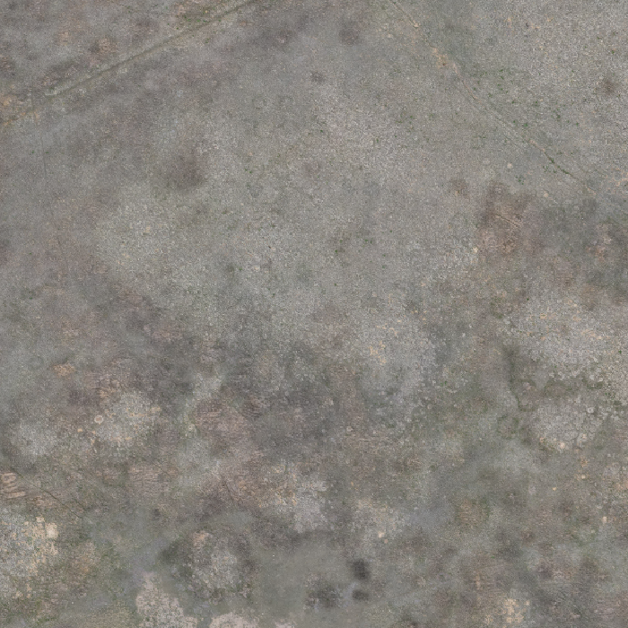 | 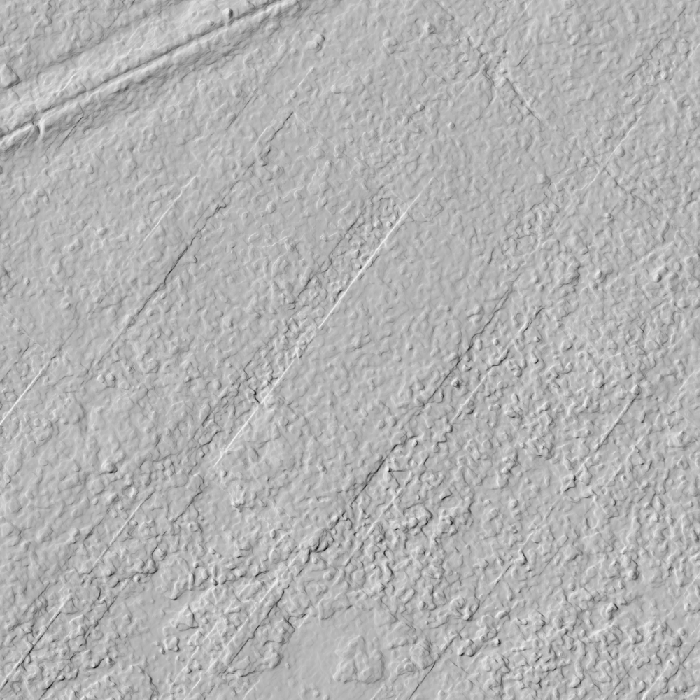 |

| Max HAG (`smrf_t05_w2`), 0 → 0.5 m | Vegetation mask, HAG ≥ 0.08 m | Vegetation mask, HAG ≥ 0.10 m |
|---|---|---|
| 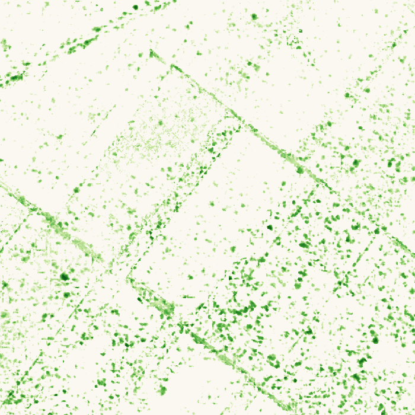 | 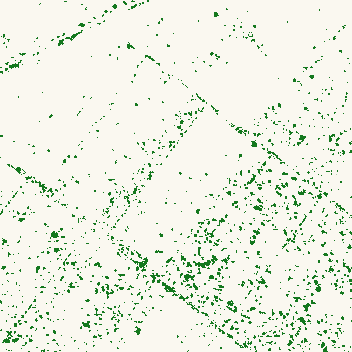 | 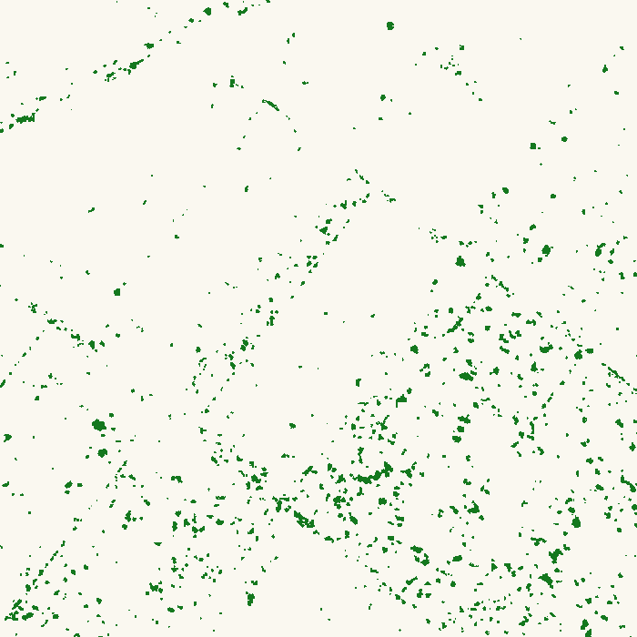 |

What this shows:

- **Real vegetation signal.** Plant clumps 0.3–1 m across, densest where the orthophoto shows darker,
  more vegetated patches (lower right).
- **Image-seam artifacts.** Straight lines forming rectangles, aligned with and perpendicular to the flight lines.
  They come from small vertical offsets (a few cm) between depth maps of neighbouring images. The faint
  striping in the hillshade is the same effect, caused by the low 50 % side overlap. On this test tile they are
  mostly **below 10 cm**: at 8 cm they still show clearly, at 10 cm they are mostly gone. That is why
  **0.10 m is the default vegetation threshold**. Elsewhere on the site, some ghost layers are thicker and
  survive the threshold. See *Artifact* below.

## Full-area result (2026-05-21_Map)

`scripts/vegetation_chm.sh processing/2026-05-21_Map 0.10` took **6 min** (PDAL 4 min, ~15 GB RAM).

| Output | Value |
|---|---|
| Points reclassified | 126.8 M, written with a `HeightAboveGround` attribute (`classified_hag.laz`, 624 MB) |
| CHM (max HAG, 10 cm) | mean 0.019 m, max 2.43 m |
| **Vegetation cover ≥ 0.10 m** | **3.9 %** of the mapped area, artifacts included (see below) |
| Fine DTM (10 cm) | 2141.86 – 2159.23 m |

| Vegetation cover (1 m cells, fraction ≥ 0.10 m) | Max height above ground (10 cm) |
|---|---|
| 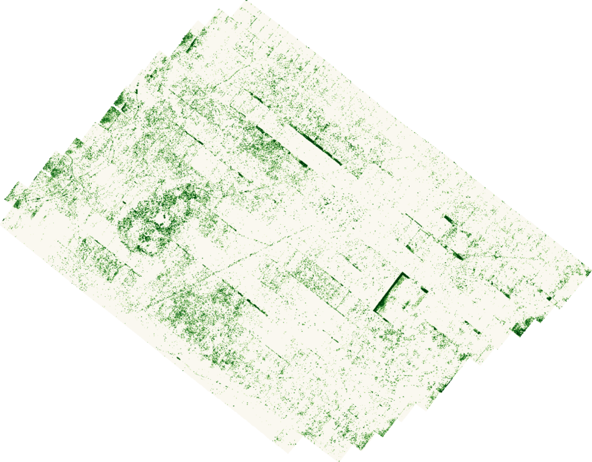 |  |

Real spatial patterns are visible: a vegetation ring around the circular feature west of centre, and
denser clumps in the darker, more vegetated patches of the orthophoto.
**There are also artifacts: straight bands and an L-shape.**

### Artifact: "ghost layers" from overlapping images

| Band A: orthophoto | Band A: max HAG | L-shape B: orthophoto | L-shape B: max HAG |
|---|---|---|---|
| 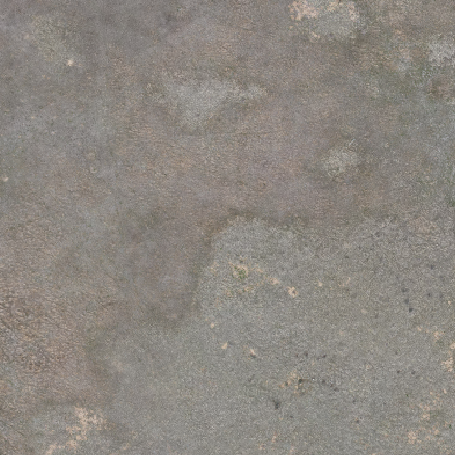 | 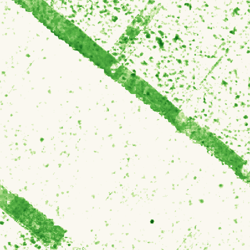 | 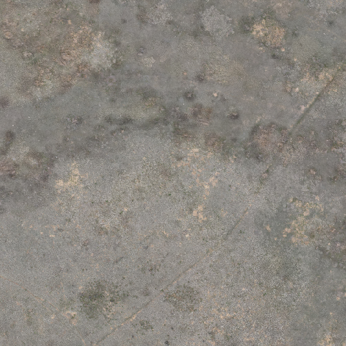 | 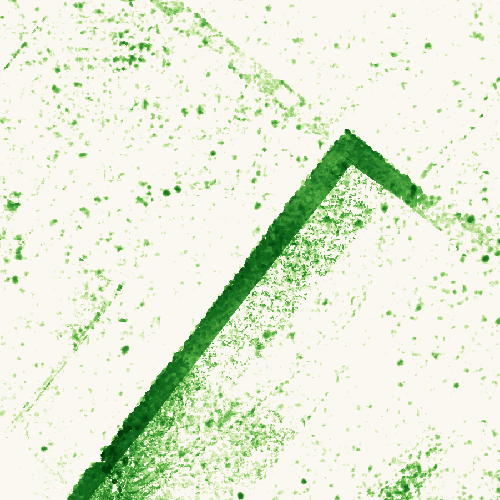 |

The bands (a few metres wide, tens to hundreds of metres long, parallel or perpendicular to the flight lines)
have no counterpart in the orthophoto. Sampling the points inside one band (1 m² at 444055 E, 4569687 N) gives
**370 points** (site average ~130/m²) in **two layers ~10 cm apart**: real ground at 2142.60 m and a ghost
surface at 2142.70 m. The two layers come from overlapping images whose depth maps disagree slightly. SMRF
correctly picks the lower layer as ground, so the ghost layer gets an HAG of 5–20 cm and is counted as
vegetation. The L-shape is the same effect along the edge of one image's footprint.

What was tried, on bands A and B and the vegetated test area T:

| Approach | Result |
|---|---|
| Smaller SMRF window (1 m, 0.6 m) | No change. The bands are not an opening/window effect. |
| Mean HAG per cell instead of max | Removes ~88 % of band A but also **~73 % of real vegetation** in T. Not used. |
| Point density to flag doubled areas | Inconsistent: band A is denser, but the L-band is not. |
| Higher height threshold | Doesn't separate them. The height distributions overlap at every threshold (0.08–0.25 m). |

**Conclusion:** on this survey, short-grass vegetation (5–20 cm) is about the same height as the photogrammetric
ghost-layer error. The products are the most sensitive version available. Read the CHM and cover maps as
"vegetation plus known straight-line artifacts", and mask or ignore the straight bands when interpreting.
Cover numbers inside a band are inflated. The root cause is the low side overlap (50 %). The flight
recommendations below would remove most of it.

## Limitations

- **Photogrammetry measures the visible top surface.** Thin grass leaves and sparse canopies are
  under-represented: dense matching smooths them and fills gaps with ground. Treat HAG values as
  **relative structure/height indices**, not field-equivalent plant heights. Calibrate with field
  measurements, e.g., pin-drop or ruler heights at GPS-located plants, before using them quantitatively.
- **Vertical noise ≈ 3–5 cm.** Vegetation below ~8–10 cm can't be told apart from noise and seam artifacts in this dataset.
- **Cover numbers depend on the threshold.** Report the threshold with any cover statistic.

## Better data next time

For finer vegetation structure from future flights:

- **Higher overlap (80 % / 75 %)** to cut seam artifacts and raise point density.
- **Add oblique images** (gimbal −60° to −70°, crosshatch pattern) to see plant sides and reduce surface smoothing.
- **Fly lower (30–40 m)** over sample plots for ~1 cm GSD.
- Fly in **calm wind** (moving grass doesn't match), and near midday to limit shadows.
- Process with `--pc-quality ultra` on small plots.
- Lidar (e.g., DJI Zenmuse L2) penetrates gaps in the canopy and gives much better ground and vegetation separation.
